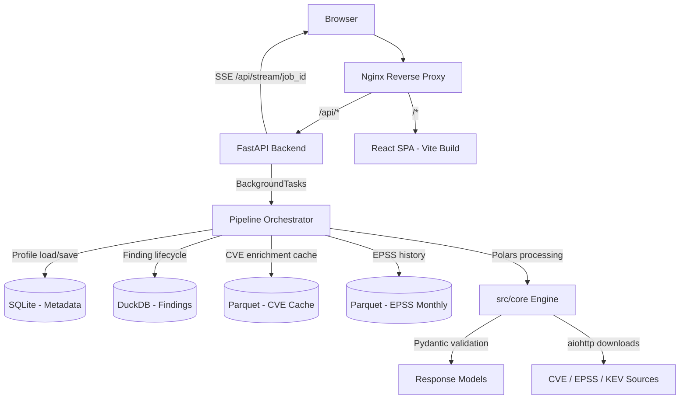

# PLAN_FORWARD.md

**Version**: 2.0
**Status**: Revised
**Date**: 2026-05-02

> **v0.3 implementation note:** This document is the original forward-looking
> plan, not a complete description of the current API. The implemented API uses
> integer profile/run IDs and uppercase scan statuses (`PENDING`, `RUNNING`,
> `DONE`, `FAILED`). See `README.md` for the implemented endpoint surface; the
> persona/trending endpoints below remain future work.

---

## 1. Executive Summary

This plan outlines the transformation of the CVEs Analytics framework from a CLI-based pipeline into a full-stack web application with **persistent environment profiles and temporal tracking**.

Three parallel streams:

1. **Pre-conditions**: Fix existing backend tech debt (duplicate logging, duplicate config, missing Pydantic output models) before any web layer is built.
2. **Backend**: FastAPI API server wrapping the existing pipeline engine, with a three-tier storage strategy (SQLite + DuckDB + Parquet).
3. **Frontend**: Persona-driven React dashboard with interactive visualizations for Executives, Security Managers, and Engineers.

**Central design decision**: A **Profile** is the primary entity — a persistent, deterministic environment definition that is scanned repeatedly over time. This enables burn-down tracking, MTTR measurement, EPSS drift analysis, and remediation velocity. A one-off scan run is a special case (a profile with one scan).

**Goal**: Deliver an interactive CVE analytics platform that answers not just "what is the risk now?" but "how is the risk changing over time, and is our remediation programme working?"

---

## 2. Pre-conditions (Must Complete Before Web Layer)

These are existing backend defects that will cause silent failures or inconsistent behaviour if inherited by the API layer. They are **blocking** for backend development.

| **Item** | **Location** | **Action** |
|----------|--------------|------------|
| Duplicate logging systems | `src/utils/logging_config.py` vs `src/cli/utils/logging_manager.py` | Delete `logging_manager.py`; use `setup_logger()` everywhere. The SSE stream depends on clean, structured log output. |
| Duplicate config systems | `src/cli/config.py` (dataclass) vs `src/utils/config.py` (Pydantic) | Delete `src/cli/config.py`; migrate `run_pipeline.py` to use `AppConfig`. |
| Missing Pydantic output models | Pipeline outputs are plain dicts | Add Pydantic v2 response models for risk scores, kill-chain, attack paths, and findings. These become FastAPI response schemas and TypeScript types via `openapi-typescript` codegen. |
| EPSS snapshotting | `EPSSTrajectory` fetches current EPSS values | At scan time, snapshot each finding's EPSS score and percentile into the Finding record. Without this, historical risk trends are silently rewritten on every new EPSS download. |

---

## 3. Architecture & Tech Stack

### 3.1. High-Level Architecture



### 3.2. Storage Strategy

The key principle: **do not migrate existing Parquet caches into SQL**. Each store is optimised for its access pattern.

| **Store** | **Technology** | **Contents** | **Access Pattern** |
|-----------|---------------|--------------|-------------------|
| Metadata | **SQLite via SQLModel** | Profiles, scan runs, job status, finding lifecycle state, remediation events | Relational CRUD; small volume |
| Findings analytics | **DuckDB** (in-process, no server) | One row per CVE per scan run; snapshotted EPSS, Bayesian risk, CI bounds, severity | Append-only writes; aggregation-heavy reads (burn-down, MTTR, velocity) |
| CVE enrichment cache | **Parquet** (existing) | 175k CVE records with CVSS vectors, CWE, descriptions | Bulk load at pipeline start; Polars lazy frame |
| EPSS monthly history | **Parquet** (existing `EPSSTrajectory`) | Monthly EPSS CSVs from FIRST.org | Time-series queries; DuckDB can query these directly alongside the findings DuckDB tables |

**Why DuckDB for findings?** Temporal aggregation queries (burn-down rate per severity per run, MTTR distributions, EPSS drift over months) are window functions and multi-run joins. SQLite handles them but becomes slow as scan history grows. DuckDB handles analytical queries natively and can `SELECT` from Parquet EPSS files in the same query as findings — no ETL needed.

### 3.3. Technology Choices

| **Layer** | **Technology** | **Rationale** |
|-----------|---------------|---------------|
| **Backend API** | **FastAPI** | Async-native, OpenAPI auto-docs, first-class Pydantic integration, SSE support. |
| **Data Processing** | **Polars** | Vectorized CVE enrichment; lazy evaluation for 175k-record datasets. |
| **Validation** | **Pydantic v2** | Strict schema enforcement at all API boundaries; source of TypeScript type codegen. |
| **Metadata DB** | **SQLite via SQLModel** | Zero-config, single-file, sufficient for profile/run/job metadata. |
| **Findings DB** | **DuckDB** | In-process columnar store; native window functions; direct Parquet queries. |
| **Async I/O** | **aiohttp** | Parallel CVE/EPSS/KEV downloads; existing usage in `epss_processor.py`. |
| **Real-time** | **SSE (Server-Sent Events)** | Pipeline progress events streamed to frontend; simpler than WebSockets for unidirectional flow. |
| **Frontend** | **React 19 + Vite 8** | Widest ecosystem for security dashboard components; TypeScript-native. |
| **Components** | **shadcn/ui (Radix)** | Headless, accessible, composable; no design team needed. |
| **Styling** | **Tailwind CSS** | Utility-first; co-located with components. |
| **Server state** | **TanStack Query v5** | Automatic background refetch for live job status; SSE integration; pagination. |
| **Client state** | **Zustand** | 10x lighter than Redux Toolkit; same predictability guarantees; ~5 lines of setup. |
| **Routing** | **React Router v7** | Persona-based route groups (`/executive`, `/manager`, `/engineer`, `/profiles`). |
| **Charts** | **Plotly.js** | First-class heatmaps, probability distributions, box plots, treemaps, time series — all needed here. |
| **Graph viz** | **Cytoscape.js** | Kill-chain and attack-path graphs; purpose-built for network graphs vs. weeks of raw D3. |
| **Tables** | **TanStack Table v8** | Virtualized, sortable, filterable CVE tables; handles 7k rows without pagination. |
| **Type codegen** | **openapi-typescript** | Generates TypeScript types from FastAPI's OpenAPI spec; single source of truth. |
| **Deployment** | **Docker Compose + Nginx** | Homelab-friendly; multi-stage builds; single-command startup. |
| **Logging** | **structlog** | Structured JSON logs; consistent with FastAPI middleware; feeds SSE event stream. |
| **Security** | **CORS + HTTPS** | Restrict CORS origins (never `*` in prod); enforce HTTPS at Nginx layer. |

**Dropped from v1.0**: Redux Toolkit (replaced by Zustand), D3.js (replaced by Plotly.js + Cytoscape.js), `poetry build` (project uses `uv`).

---

## 4. Profile & Historization Model

### 4.1. Core Entities

Historization requires three new first-class entities. A **Profile** is the primary entity — not a scan run.

```
profiles                          scan_runs
┌──────────────────────────────┐  ┌──────────────────────────────────┐
│ id (INTEGER)                 │──│ id (INTEGER)                     │
│ name                         │  │ profile_id → profiles.id         │
│ org_size                     │  │ started_at, completed_at         │
│ industry                     │  │ status (PENDING/RUNNING/DONE/FAILED) │
│ environment                  │  │ epss_vintage (YYYY-MM)           │
│ org_reach                    │  │ cve_data_vintage (date)          │
│ security_maturity            │  │ total_findings                   │
│ controls_snapshot (JSON)     │  │ critical_count, high_count       │
│ image_inventory (JSON)       │  │ avg_bayesian_risk                │
│ created_at, updated_at       │  │ kill_chain_json                  │
└──────────────────────────────┘  └──────────────────────────────────┘
                                              │
                                              ▼
                                     findings (DuckDB)
                             ┌────────────────────────────────────────┐
                             │ id, profile_id, scan_run_id            │
                             │ cve_id                                 │
                             │ image_name, image_tag, service_name   │
                             │ cvss_score        ← snapshotted        │
                             │ epss_score        ← snapshotted        │
                             │ epss_percentile   ← snapshotted        │
                             │ bayesian_risk, ci_low, ci_high         │
                             │ severity_reassessed                    │
                             │ status (open / in_progress /           │
                             │         resolved / accepted_risk /     │
                             │         wont_fix)                      │
                             │ first_seen_run_id                      │
                             │ resolved_run_id (nullable)             │
                             └────────────────────────────────────────┘
```

### 4.2. ScenarioGenerator — Two Modes Required

The existing `ScenarioGenerator` produces a fully random environment on every run (UUID, Faker, probabilistic control selection). For historization, it must support:

| **Mode** | **Method** | **Behaviour** |
|----------|-----------|---------------|
| Create profile | `generate_new_profile()` | Runs random generation once; serialises frozen result to `profiles` table as `controls_snapshot` (JSON) |
| Load profile | `load_profile(profile_id)` | Reads stored profile; deterministic — same control LRs every scan |
| Update profile | `apply_profile_delta(profile_id, delta)` | Applies explicit changes (e.g. WAF upgraded from Basic → OWASP CRS; `nginx:1.24` → `nginx:1.26`); creates new profile version |

This ensures the risk delta between two scan runs is attributable to real changes (new CVEs published, EPSS shifts, image updates, control upgrades) not to generator randomness.

### 4.3. Temporal Metrics Definitions

| **Metric** | **Formula** | **Answers** |
|------------|------------|------------|
| **Burn-down ratio** | `open(run_N) / open(run_1)` | Is the backlog actually shrinking? |
| **Remediation velocity** | `resolved(run_N) - new(run_N)` per run | Are we closing faster than new findings arrive? |
| **MTTR by severity** | `avg(resolved_run.started_at − first_seen_run.started_at)` grouped by severity | How long does it take to fix Critical vs High vs Medium? |
| **Time to Arrival (TTA)** | `first_seen_run.started_at − cve.date_published` | How quickly do we detect newly published CVEs? |
| **EPSS drift** | `epss_score(current_run) − epss_score(first_seen_run)` for open findings | Which open CVEs are becoming more actively exploited? |
| **Recurrence rate** | Count of findings resolved then reappearing in a later run | Are fixes actually permanent? |
| **Risk score trend** | `avg(bayesian_risk)` over runs per profile | Is the overall Bayesian risk posture improving? |
| **Kill-chain trend** | Overall kill-chain probability per run | Is defence-in-depth improving over time? |

---

## 5. Backend — API Surface

### 5.1. Profile & Scan Endpoints

```
POST   /api/profiles                               Create new environment profile
GET    /api/profiles                               List all profiles
GET    /api/profiles/{id}                          Profile detail + latest scan summary
PATCH  /api/profiles/{id}                          Update mutable profile fields
DELETE /api/profiles/{id}                          Delete profile when no scans are active

POST   /api/profiles/{id}/scans                    Trigger new scan run against profile (returns job_id)
GET    /api/profiles/{id}/scans                    List scan runs chronologically
GET    /api/profiles/{id}/scans/{run_id}           Single run detail
GET    /api/profiles/{id}/scans/{run_id}/findings  Paginated findings for one run
DELETE /api/profiles/{id}/scans/{run_id}           Delete completed run and findings
```

### 5.2. Findings Endpoints

```
GET    /api/profiles/{id}/findings                 All findings across runs (paginated, filterable by status/severity/service)
PUT    /api/profiles/{id}/findings/{finding_id}    Update finding status (in_progress / accepted_risk / wont_fix)
GET    /api/profiles/{id}/findings/persistent      CVEs open across all scans (never resolved)
GET    /api/profiles/{id}/findings/new             Findings first seen in latest run
GET    /api/profiles/{id}/findings/resolved        Findings resolved in latest run
```

### 5.3. Temporal Analytics Endpoints

```
GET    /api/profiles/{id}/trends                   All temporal metrics (combined)
GET    /api/profiles/{id}/trends/burndown          Severity count per run (for stacked area chart)
GET    /api/profiles/{id}/trends/velocity          Opened vs closed per run (for waterfall/bar chart)
GET    /api/profiles/{id}/trends/mttr              MTTR distributions by severity (for box plot)
GET    /api/profiles/{id}/trends/tta               Time-to-arrival distribution (for histogram)
GET    /api/profiles/{id}/trends/epss-drift        EPSS change for open findings since first seen
GET    /api/profiles/{id}/trends/risk-score        Average Bayesian risk over runs (for line chart)
GET    /api/profiles/{id}/trends/killchain         Kill-chain probability over runs
```

### 5.4. Single-Run Endpoints (unchanged from one-off scans)

```
GET    /api/profiles/{id}/scans/{run_id}/cves          Paginated, filtered CVE list for run
GET    /api/profiles/{id}/scans/{run_id}/risk           Bayesian risk summary + distribution
GET    /api/profiles/{id}/scans/{run_id}/killchain      Stage probabilities + contributing controls
GET    /api/profiles/{id}/scans/{run_id}/attackpaths    Graph nodes/edges JSON for Cytoscape
GET    /api/profiles/{id}/scans/{run_id}/remediation    Phased remediation roadmap
GET    /api/epss/trajectory/{cve_id}                   90-day EPSS time series (from EPSSTrajectory)
GET    /api/profiles/{id}/scans/{run_id}/export        Text/markdown report export

GET    /api/stream/{job_id}                            SSE: pipeline progress events
```

### 5.5. Modular Backend Structure

```
src/
├── api/                          ← NEW: FastAPI layer
│   ├── main.py                   ← App factory, CORS, middleware
│   ├── routers/
│   │   ├── profiles.py
│   │   ├── scans.py
│   │   ├── findings.py
│   │   ├── trends.py
│   │   └── stream.py             ← SSE endpoint
│   ├── schemas/                  ← Pydantic response models (source for TS codegen)
│   │   ├── profile.py
│   │   ├── finding.py
│   │   ├── risk.py
│   │   ├── killchain.py
│   │   └── trends.py
│   └── dependencies.py           ← DB session injection, config injection
├── db/                           ← NEW: persistence layer
│   ├── sqlite_models.py          ← SQLModel ORM models (profiles, scan_runs, jobs)
│   ├── duckdb_store.py           ← DuckDB findings store (append, query, aggregate)
│   └── migrations/               ← Alembic for SQLite schema migrations
├── core/                         ← EXISTING: analytics engine (unchanged)
├── simulation/                   ← EXISTING: scenario generation (add two-mode support)
├── cli/                          ← EXISTING: keep for direct CLI use
└── utils/                        ← EXISTING: config, logging (after pre-conditions resolved)
```

### 5.6. Performance Targets

| **Metric** | **Target** | **Measurement** |
|------------|------------|-----------------|
| API query latency (single run) | < 100ms | FastAPI middleware timing |
| Burn-down query (12 runs, 3k findings) | < 200ms | DuckDB explain + timeit |
| CVE enrichment throughput | > 10k CVEs/sec | Polars benchmark |
| Pipeline SSE first event | < 2s from trigger | Browser DevTools |
| Memory footprint (backend idle) | < 300MB | `memory_profiler` |

---

## 6. Frontend — Persona-Driven Dashboard

### 6.1. Tech Stack

| **Layer** | **Technology** | **Notes** |
|-----------|---------------|-----------|
| Bundler | **Vite 8** | Fast HMR; `vite build` for production |
| Framework | **React 19** | TypeScript strict mode |
| Components | **shadcn/ui** | Radix-based headless; copy-paste into project; no design team needed |
| Styling | **Tailwind CSS v4** | Utility-first; co-located with components |
| Routing | **React Router v7** | File-based routes per persona |
| Server state | **TanStack Query v5** | Caching, background refetch, SSE integration for job status |
| Client state | **Zustand** | Profile selection, active run, filter state |
| Charts | **Plotly.js** | Heatmaps, box plots, probability distributions, treemaps, stacked area, waterfall |
| Graph viz | **Cytoscape.js** | Kill-chain flow diagrams; attack-path graphs |
| Tables | **TanStack Table v8** | Virtualized rows; sortable/filterable; inline status editing |
| Type safety | **openapi-typescript** | Generates TS types from `/api/openapi.json`; run as pre-build step |
| Icons | **Lucide React** | Consistent, tree-shakeable |

### 6.2. Route Structure

```
/                         → redirect to /profiles
/profiles                 → Profile list + create form
/profiles/:id             → Profile overview (latest scan summary)
/profiles/:id/scans/:runId → Single run detail (existing one-off view)

/profiles/:id/executive   → Executive persona view
/profiles/:id/manager     → Security Manager persona view
/profiles/:id/engineer    → Engineer persona view
```

### 6.3. Persona Views

#### Executive (`/profiles/:id/executive`)

| **Component** | **Data Source** | **Chart Type** |
|--------------|----------------|---------------|
| Risk tier summary cards | `trends/risk-score` | KPI cards (Critical/High/Medium count + trend arrow) |
| Bayesian risk trend | `trends/risk-score` | Line chart (avg risk over runs) |
| Burn-down overview | `trends/burndown` | Stacked area chart (severity × runs) |
| Kill-chain trend | `trends/killchain` | Line chart (overall probability over runs) |
| Remediation velocity | `trends/velocity` | Grouped bar (opened vs closed per run) |

#### Security Manager (`/profiles/:id/manager`)

| **Component** | **Data Source** | **Chart Type** |
|--------------|----------------|---------------|
| Severity × service heatmap | `scans/{run_id}/risk` | Plotly heatmap |
| EPSS drift table | `trends/epss-drift` | Table: CVE ID, first EPSS, current EPSS, delta, status |
| MTTR by severity | `trends/mttr` | Box plot per severity tier |
| Persistent threats | `findings/persistent` | Table: open across N scans, EPSS trend sparkline |
| Remediation roadmap | `scans/{run_id}/remediation` | Phased list with effort estimates |
| Control effectiveness | profile `controls_snapshot` | Radar chart of active control tiers |

#### Engineer (`/profiles/:id/engineer`)

| **Component** | **Data Source** | **Chart Type** |
|--------------|----------------|---------------|
| CVE findings table | `findings` | TanStack Table v8 (virtualized, inline status edit) |
| Attack path graph | `scans/{run_id}/attackpaths` | Cytoscape.js force-directed graph |
| Kill-chain diagram | `scans/{run_id}/killchain` | Cytoscape.js flow diagram with stage probabilities |
| Per-CVE credible interval | `scans/{run_id}/risk` | Horizontal box plot (risk CI per CVE) |
| EPSS 90-day trajectory | `epss/trajectory/{cve_id}` | Plotly line chart (per selected CVE) |
| TTA distribution | `trends/tta` | Histogram (days from CVE publish to first detected) |

### 6.4. Performance Targets

| **Metric** | **Target** | **Tool** |
|------------|------------|----------|
| Lighthouse score | > 90 | Chrome DevTools |
| Time to Interactive | < 2s | WebPageTest |
| CVE table (7k rows) | Smooth scroll | TanStack Table virtual rows |
| Bundle size (initial) | < 400KB gzipped | `vite-bundle-visualizer` (Plotly lazy-loaded per route) |

---

## 7. Risk Mitigation

| **Risk** | **Mitigation** |
|----------|---------------|
| **EPSS score rewrite** | Snapshot EPSS at scan time in Finding record (pre-condition item) |
| **ScenarioGenerator randomness** | Freeze generated environment as `controls_snapshot` JSON in profile; repeat scans load from profile |
| **Image tag ambiguity** | Store `image_tag` in Finding; flag floating tags (`:latest`) as unresolvable for MTTR |
| **DuckDB concurrent writes** | Pipeline writes findings only when scan completes; API is read-only on DuckDB; no write contention |
| **Schema drift (CVE v5)** | Pydantic strict validation at ingest; version-tagged Parquet cache files |
| **Frontend bundle size** | Plotly and Cytoscape lazy-loaded per route via `React.lazy`; code split by persona |
| **Legacy CLI compatibility** | CLI remains functional; `VulnerabilityAssessmentPipeline` is wrapped, not replaced |
| **Third-party API rate limits** | Existing retry + cache logic in `epss_processor.py` and `cwe_processor.py` unchanged |
| **SQLite write locking** | SQLite only used for metadata (profiles, job status); findings go to DuckDB; concurrent pipeline + API read is safe |

---

## 8. Deployment

### 8.1. Docker Compose

```yaml
services:
  backend:
    build:
      context: .
      dockerfile: Dockerfile.backend     # python:3.12-slim + uv
    volumes:
      - ./data:/app/data                  # Parquet CVE cache + EPSS
      - ./output:/app/output             # Generated reports
      - ./db:/app/db                     # SQLite + DuckDB files
    ports: ["8000:8000"]
    environment:
      - APP_ENV=production

  frontend:
    build:
      context: ./frontend
      dockerfile: Dockerfile.frontend    # node:22-alpine build → nginx:alpine serve
    ports: ["3000:3000"]

  nginx:
    image: nginx:alpine
    volumes:
      - ./nginx.conf:/etc/nginx/nginx.conf:ro
    ports: ["80:80", "443:443"]
    depends_on: [backend, frontend]
```

### 8.2. CI/CD Pipeline

| **Stage** | **Action** | **Tool** |
|-----------|------------|----------|
| Lint + type check | `ruff check`, `mypy` (backend); `tsc --noEmit` (frontend) | GitHub Actions |
| Test | `pytest` + `pytest-asyncio` (backend); Vitest (frontend) | GitHub Actions |
| Security scan | `bandit` (SAST); `uv audit` (deps); `trivy` (Docker images) | GitHub Actions |
| TS type codegen | `openapi-typescript` from running backend OpenAPI spec | Pre-build step |
| Build | `uv build` (backend); `vite build` (frontend) | GitHub Actions |
| Deploy | `docker compose up -d` | Self-hosted runner or manual |

### 8.3. Rollout Phases

| **Phase** | **Scope** | **Completion Criteria** |
|-----------|-----------|------------------------|
| **Phase 0** | Pre-conditions (logging, config, Pydantic models, EPSS snapshotting) | All four blocking items resolved; existing CLI tests pass |
| **Phase 1** | Backend API + SQLite + DuckDB; profile create/scan; single-run endpoints | FastAPI serves all single-run endpoints; pipeline triggers via API; SSE streams progress |
| **Phase 2** | Historization: findings persistence, delta computation, temporal endpoints | Burn-down, velocity, MTTR endpoints return correct data across ≥3 test scan runs |
| **Phase 3** | Frontend: Profile Manager + Engineer view + Security Manager view | TanStack Table, Cytoscape kill-chain graph, and burn-down chart functional |
| **Phase 4** | Frontend: Executive view + EPSS drift + TTA charts | All persona views complete; `openapi-typescript` codegen in CI |

---

## 9. Monitoring & Observability

For homelab deployment, a lightweight stack is appropriate. ELK/Prometheus/Jaeger are over-engineered for a single-instance deployment.

| **Aspect** | **Tool** | **Notes** |
|------------|----------|-----------|
| Structured logging | **structlog** (JSON) | FastAPI request middleware + pipeline step events |
| Log storage | **File rotation** (`logging.handlers.RotatingFileHandler`) | Existing `pipeline_run.log` pattern; keep it simple |
| Metrics (optional) | **Prometheus + Grafana** | Add if multi-user deployment; single counter/histogram per endpoint |
| Health check | `GET /api/health` | Returns DB connectivity, last successful scan timestamp |
| Error alerting | **Apprise** (lightweight) | Sends notifications to Slack/email on pipeline failure; optional |

---

## 10. Appendix

### 10.1. Glossary

| **Term** | **Definition** |
|----------|----------------|
| CVE | Common Vulnerabilities and Exposures |
| CVSS | Common Vulnerability Scoring System |
| EPSS | Exploit Prediction Scoring System — monthly probability of exploitation |
| KEV | CISA Known Exploited Vulnerabilities catalog |
| LR | Likelihood Ratio — evidence weight in Bayesian risk calculation |
| MTTR | Mean Time to Remediate — time from first detection to resolved status |
| TTA | Time to Arrival — lag between CVE publication date and first scan detection |
| Profile | Persistent, deterministic environment definition scanned repeatedly over time |
| Finding | A CVE instance within a profile, with lifecycle state tracked across runs |
| SBOM | Software Bill of Materials |

### 10.2. Key Decisions Log

| **Decision** | **Rationale** | **Alternatives Rejected** |
|---|---|---|
| DuckDB for findings | Analytical aggregation (burn-down, MTTR) over large finding sets; direct Parquet query | SQLite (slow for window functions at scale); PostgreSQL (over-engineered for homelab) |
| Zustand over Redux Toolkit | 10x less boilerplate; same guarantees for this use case | Redux Toolkit (excessive ceremony for a single-user app) |
| Plotly.js + Cytoscape.js over D3.js | Statistical charts (box plots, heatmaps, probability distributions) and graph layouts out of the box | D3.js (weeks of custom implementation for kill-chain graphs and probability distributions) |
| shadcn/ui over component library | Headless/accessible; code is owned, not imported; no design team dependency | MUI, Ant Design (opinionated styling hard to override; larger bundles) |
| Profile as primary entity | Historization requires a stable identity that scan runs attach to | Scan-first model (cannot answer "how has this environment's risk changed over time?") |
| Parquet stays as CVE cache | Already optimised; 175k records load in 0.1s from cache; Polars-native | Migrating to SQL (unnecessary work, would lose Polars lazy evaluation benefits) |

### 10.3. References

- [FastAPI Documentation](https://fastapi.tiangolo.com/)
- [DuckDB Documentation](https://duckdb.org/docs/)
- [Polars Documentation](https://docs.pola.rs/)
- [TanStack Query v5](https://tanstack.com/query/latest)
- [TanStack Table v8](https://tanstack.com/table/latest)
- [shadcn/ui](https://ui.shadcn.com/)
- [Plotly.js](https://plotly.com/javascript/)
- [Cytoscape.js](https://js.cytoscape.org/)
- [Zustand](https://zustand-demo.pmnd.rs/)
- [openapi-typescript](https://openapi-ts.dev/)
- [React Router v7](https://reactrouter.com/)